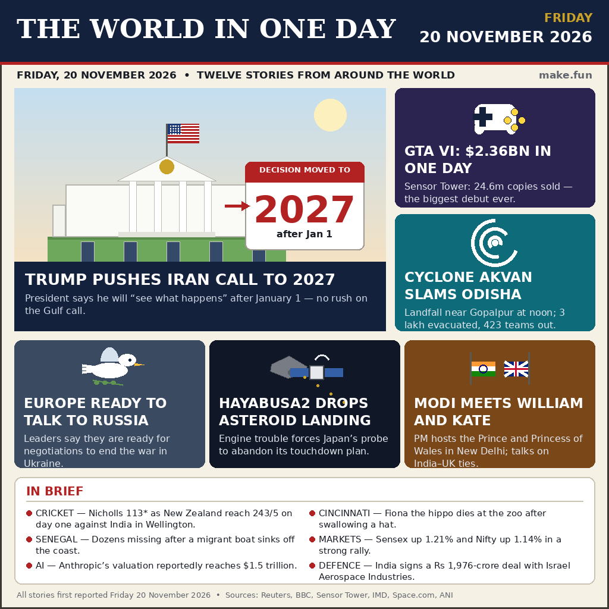

# The World in One Day — Friday 20 November 2026

[](https://make.fun/c/news-image-20261120)
[](https://make.fun/c/news-image-20261120)
[](https://make.fun/c/news-image-20261120)

Entry for the [make.fun news-image-20261120 competition](https://make.fun/c/news-image-20261120):
a single newspaper front page summarising the day's news — Friday 20 November 2026 —
in one image. Twelve real stories, all first reported on 20 November 2026.



## The twelve stories

**Lead:** Trump pushes the Iran war decision to 2027 — he will "see what
happens" after January 1, with no rush on the call that has shadowed the Gulf.

1. **GTA VI: $2.36bn in one day** — Sensor Tower: 24.6m copies sold, the
   biggest entertainment debut ever.
2. **Cyclone Akvan slams Odisha** — landfall near Gopalpur at noon; 3 lakh
   evacuated, 423 rescue teams out.
3. **Europe ready to talk to Russia** — leaders say they are ready for
   negotiations to end the war in Ukraine.
4. **Hayabusa2 drops asteroid landing** — engine trouble forces Japan's probe
   to abandon its touchdown plan.
5. **Modi meets William and Kate** — the PM hosts the Prince and Princess of
   Wales in New Delhi; talks on India–UK ties.

**In brief:** Nicholls 113\* as New Zealand reach 243/5 on day one against
India in Wellington · Fiona the hippo dies at Cincinnati Zoo after swallowing
a hat · dozens missing after a migrant boat sinks off Senegal · Sensex up
1.21% and Nifty up 1.14% · Anthropic's valuation reportedly reaches $1.5
trillion · India signs a Rs 1,976-crore defence deal with Israel Aerospace
Industries.

Sources: Reuters, BBC, Sensor Tower, IMD, Space.com, ANI.

## Reproduce

```sh
python3 render.py   # writes entry.png (1024x1024, deterministic)
python3 main.py     # verifies entry.png and copies it to /output/entry.png
```

`render.py` draws the whole front page with Pillow (no network, no randomness).
`main.py` is the entrypoint: it checks the PNG signature, the 1024×1024 size,
the 1 MiB limit and the SHA-256 of `entry.png`, then copies it to
`/output/entry.png`.

## License

MIT — see [LICENSE](LICENSE).
